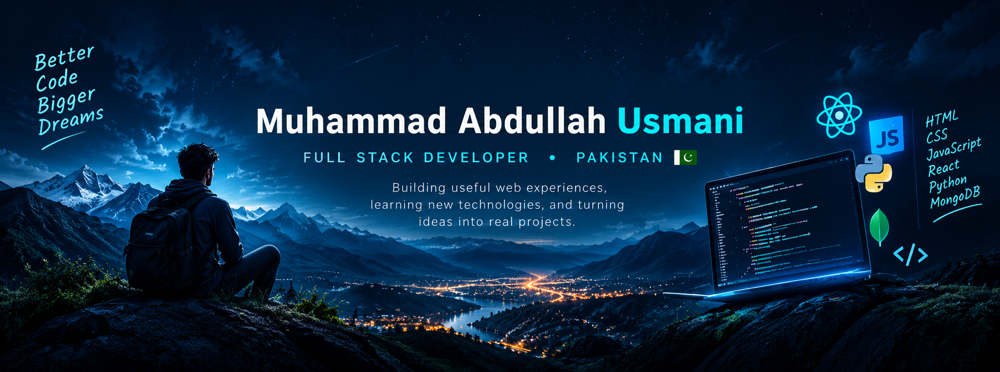

  

<h1 align="center">Hi there, I'm Abdullah 👋</h1>

<h3 align="center">Full Stack Developer in Progress | Pakistan 🇵🇰</h3>

  Building useful web experiences, learning new technologies,
  and turning ideas into real projects.

  
  
  

---

## 👨‍💻 About Me

- 🇵🇰 Based in Pakistan.
- 🌐 Interested in full-stack web development.
- 🛠️ Building real-world projects and improving my skills.
- 📚 Learning backend development, databases, and system design.
- 🎯 Focused on writing useful code and building practical products.

## 💻 Tech Stack

### Frontend

  
  
  
  
  

### Backend & Database

  
  
  

### Tools & Platforms

  
  
  
  
  
  

---

## 🚀 Featured Projects

### 1. Muslim Medical Mission
A humanitarian and medical relief website built to present the organization's mission and initiatives.

- **Live demo:** [mmm02-4uk.pages.dev](https://mmm02-4uk.pages.dev)
- **Technology:** React / Next.js and related web technologies

### 2. Personal Portfolio
My developer portfolio showcasing my skills, projects, and journey.

- **Live website:** [muhammadabdullahusmani.vercel.app](https://muhammadabdullahusmani.vercel.app)

### 3. Study Sphere
An education-focused project for organizing and accessing learning resources.

- **Repository:** Add your Study Sphere repository link here.

### 4. Metro WooCommerce Frontend
A frontend practice project inspired by the RadiusTheme Metro design.

- **Repository:** Add your Metro project repository link here.

---

## 🌱 Currently Focused On

- Improving JavaScript and React skills.
- Building stronger backend and database knowledge.
- Learning FastAPI and system design.
- Developing and deploying practical web applications.

---

## 📊 GitHub Statistics

  
  

  

---

## 🤝 Connect With Me

  <a href="https://github.com/MuhammadAbdullahUsmani2008">
    GitHub
  </a>
  &nbsp; • &nbsp;
  <a href="https://muhammadabdullahusmani.vercel.app">
    Portfolio
  </a>

  <i>Code • Learn • Build • Grow 🚀</i>

